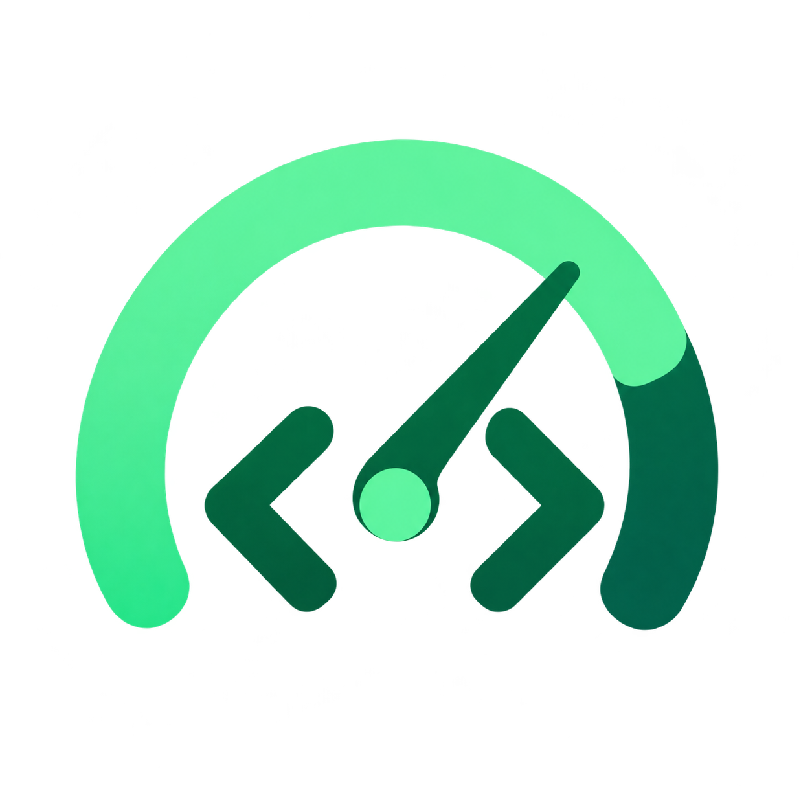
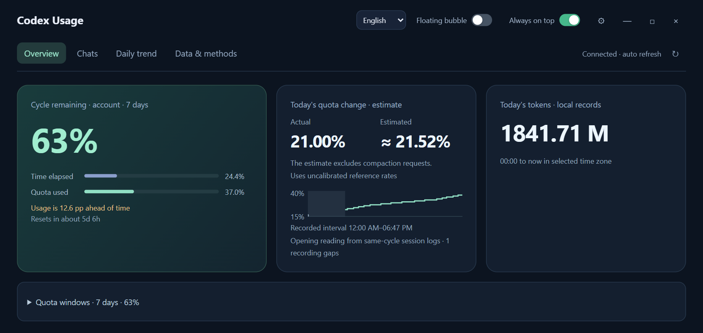
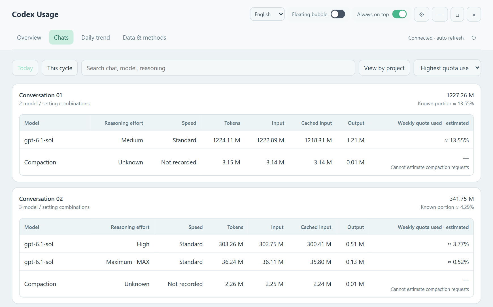

<h1 align="center">CodexGauge</h1>

<strong>See how much Codex quota you have left and where your usage goes.</strong>

<strong>English</strong> · <a href="docs/README.zh-CN.md">简体中文</a> · <a href="docs/README.zh-TW.md">繁體中文</a> · <a href="docs/README.ja.md">日本語</a>

  <a href="https://github.com/HiokiAyu/codex-gauge/releases/tag/ota-preview"><strong>Download for Windows</strong></a> ·
  <a href="CHANGELOG.md">Version history</a> ·
  <a href="CONTRIBUTING.md">Build & contribute</a>

Windows x64 · Preview · MIT

Captured on Windows 11 with the running dashboard’s data. Conversation names are replaced.

## Read the dashboard

- **Weekly quota** See your remaining allowance next to elapsed cycle time. The floating gauge keeps the remaining percentage visible while you work.
- **Today’s usage** Compare the change in account quota readings with the estimated usage from local conversations. The chart marks gaps in collection.
- **Daily totals** See how local Token totals compare with the account’s daily totals. The tray records the time and amount of any later revisions.
- **Reset and reset-card alerts** CodexGauge monitors multiple sources for automatic reset and saved reset-card announcements. The tray can notify you about new reports, and the dashboard shows where each report came from and whether sources agree.

## Go from the total to a conversation

See input, cached input, and output tokens for each model and reasoning setting in a conversation. Switch between today and the current cycle, or group your work into projects and export a CSV.

## Get started

1. Download the Windows x64 installer under **Assets** on the preview release page. Sign in to the local Codex client with your subscription account. The installer can install Microsoft Edge WebView2 if needed.
2. Open **Overview** to see your weekly quota. In **Settings**, choose your language, theme, and session folder.
3. Click **×** to keep collecting in the Windows tray. Use the tray menu to exit or **Settings → Check for updates** to get signed preview updates.

CodexGauge is an independent project tested on Windows 11 x64. The OTA manifest is signed. Windows may show an unsigned publisher prompt for the standalone installer.

## Data sources and privacy

CodexGauge reads your signed-in Codex client and local session logs. Account readings, local Token counts, and quota estimates have their own labels. Estimates depend on log coverage and calibration. Logs and the usage database stay on your device. Update checks contact GitHub, and optional reset news contacts the listed sources.

[Report an issue](https://github.com/HiokiAyu/codex-gauge/issues) · [MIT License](LICENSE)
