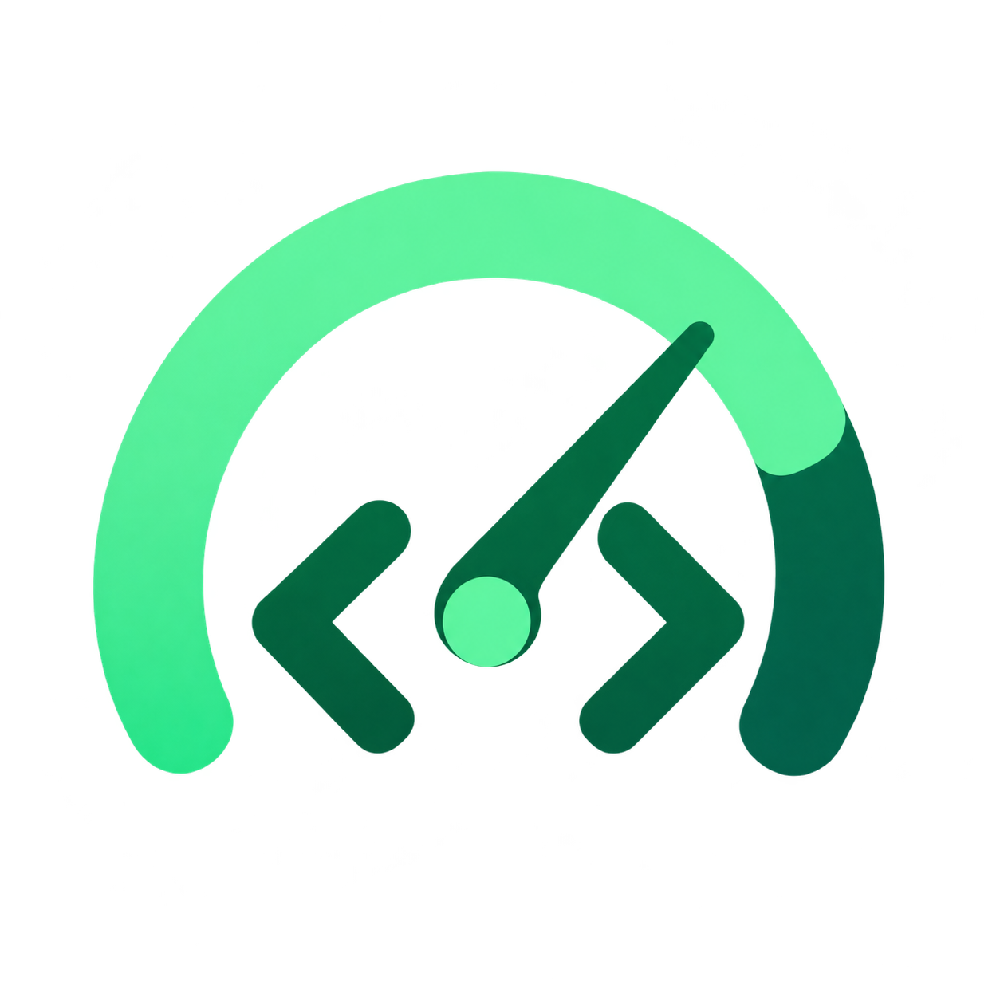
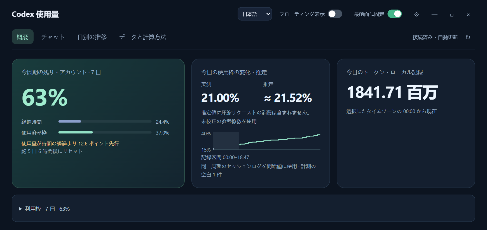
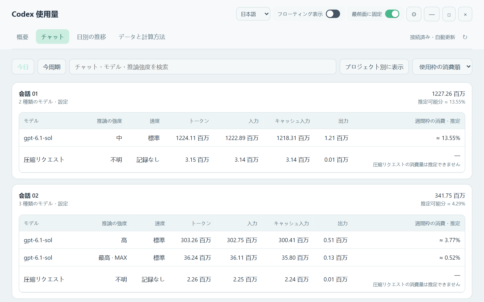

<h1 align="center">CodexGauge</h1>

<strong>Codex の残り使用枠と、どの会話にどれだけ使ったかをひと目で。</strong>

<a href="../README.md">English</a> · <a href="README.zh-CN.md">简体中文</a> · <a href="README.zh-TW.md">繁體中文</a> · <strong>日本語</strong>

  <a href="https://github.com/HiokiAyu/codex-gauge/releases/tag/ota-preview"><strong>Windows 版をダウンロード</strong></a> ·
  <a href="../CHANGELOG.md">変更履歴</a> ·
  <a href="../CONTRIBUTING.md">ビルドと開発への参加</a>

Windows x64 · プレビュー版 · MIT

Windows 11 で稼働中の画面を撮影。使用量は実測データを使用し、会話名は置き換えています。

## 概要画面でわかること

- **週間使用枠の残り** 現在の残りと周期の経過を並べて確認できます。フローティング表示では作業中も残りの割合を確認できます。
- **今日使った分** アカウントの使用枠の変化とローカルの会話から求めた推定値を比較できます。グラフには取得が途切れた区間も表示します。
- **公式の日次集計の修正** データと計算方法の画面で公式とローカルの集計を比較できます。トレイに格納している間も修正の検知時刻と増減を記録します。
- **リセットとリセットカードの通知** 自動リセットや貯めて使えるリセットカードの告知を複数の情報源で確認し、新着をトレイに通知できます。各情報源と照合結果は画面で確認できます。

## 会話の内訳を確認する

同じ会話でモデルや推論強度を切り替えた場合も、設定ごとに入力、キャッシュ、出力の Token を表示します。今日と現在の周期を切り替えたり、プロジェクト別に集計して CSV に出力したりできます。

## インストールと使い方

1. プレビュー版の **Assets** から Windows x64 用インストーラーをダウンロードし、ローカルの Codex にサブスクリプションのアカウントでログインしてください。必要に応じて Microsoft Edge WebView2 も導入できます。
2. **概要**で週間使用枠を確認し、右上の**設定**で言語、テーマ、会話フォルダーを選べます。
3. **×** でシステムトレイに格納し、バックグラウンドで収集を続けられます。終了はトレイメニューから、更新は **設定 → 更新を確認** から行えます。

Windows 11 x64 で動作確認した独立プロジェクトのプレビュー版です。OTA 情報には署名があり、単体インストーラーには未署名の発行元について Windows が警告を表示する場合があります。

## データの取得元とプライバシー

CodexGauge はログイン済みのローカル Codex クライアントと会話ログを読み込みます。アカウントの使用枠、ローカルの Token、推定値は個別に表示し、推定値はログの範囲と校正結果に依存します。ログと使用量データベースは端末内に保存されます。更新確認は GitHub に接続し、オプションのリセット情報は画面に表示される提供元に接続します。

[問題を報告する](https://github.com/HiokiAyu/codex-gauge/issues) · [MIT ライセンス](../LICENSE)
