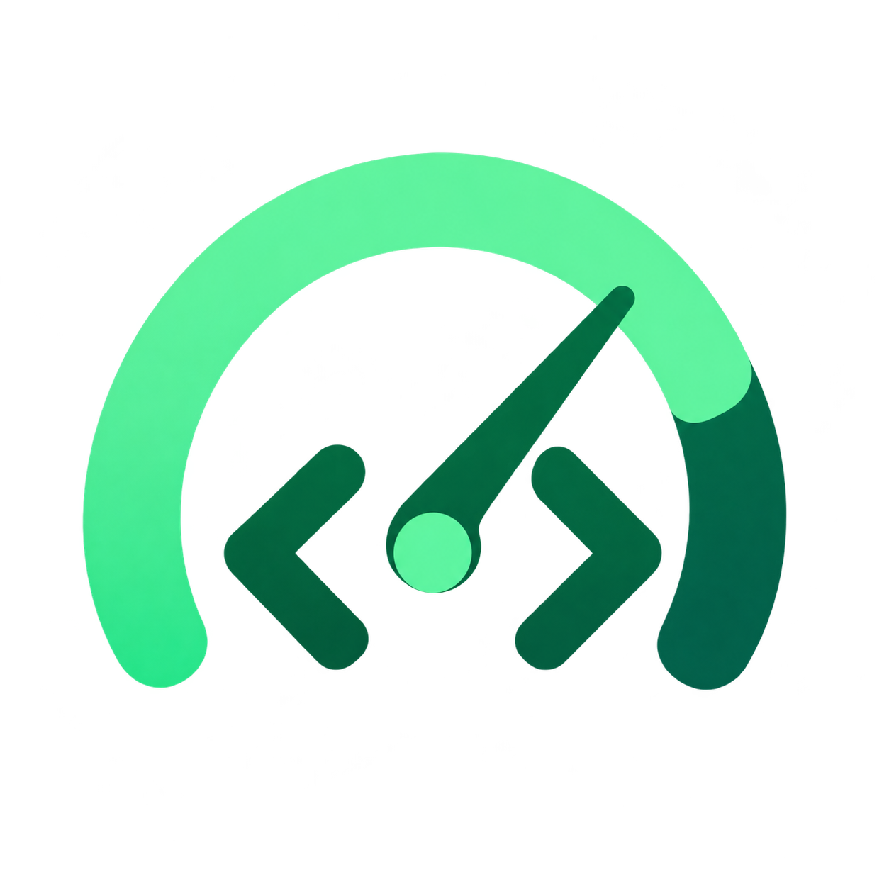
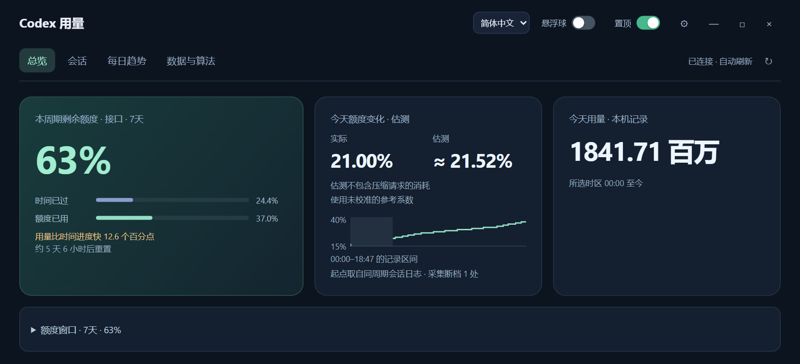
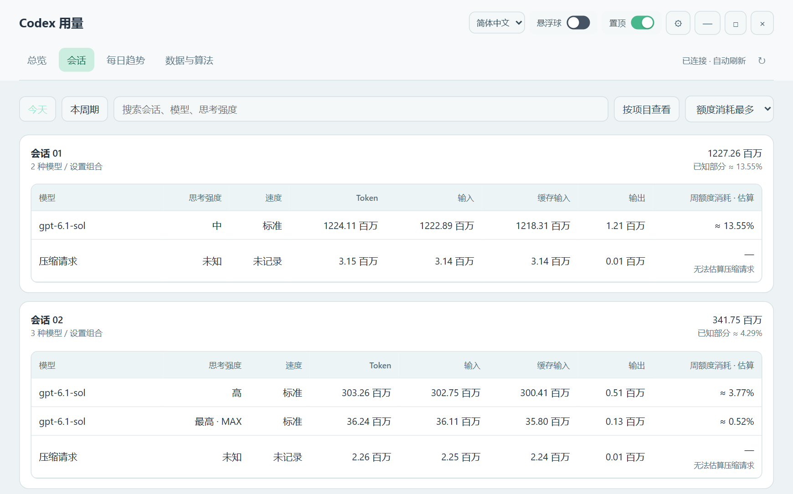

<h1 align="center">CodexGauge · Codex 大看板</h1>

<strong>周额度还剩多少，今天主要花在哪，打开看板就知道。</strong>

<a href="../README.md">English</a> · <strong>简体中文</strong> · <a href="README.zh-TW.md">繁體中文</a> · <a href="README.ja.md">日本語</a>

  <a href="https://github.com/HiokiAyu/codex-gauge/releases/tag/ota-preview"><strong>下载 Windows 安装包</strong></a> ·
  <a href="../CHANGELOG.md">版本历史</a> ·
  <a href="../CONTRIBUTING.md">构建与参与开发</a>

Windows x64 · 预览版 · MIT

截图取自 Windows 11 上正在运行的看板。用量数字保留，会话标题已替换。

## 总览能回答什么

- **额度花得快吗？** 把周剩余额度和周期进度放在一起看。需要常驻时，可以只开浮动球查看剩余百分比。
- **今天用了多少？** 并列显示账户额度读数的变化和本机会话用量估测，曲线会标出采集断档。
- **官方日汇总后来变了吗？** 在数据与算法页核对官方与本机的每日 Token。工具会在托盘记录后续修订的发现时间和变化量。
- **有新的重置或重置卡公告吗？** 工具自动巡检多个消息源，发现新的自动重置或可保存的重置卡公告时可弹出托盘提醒。看板列出各条消息的来源和比对结果，方便核实。

## 把用量拆到每个会话

同一会话切过模型或思考强度，也能按设置拆开看输入、缓存和输出 Token。可以切换今天与本周期，或者按项目汇总并导出 CSV。

## 安装和使用

1. 前往预览发布页的 **Assets** 下载 Windows x64 安装包，并在本机 Codex 登录订阅账号。安装程序可补装 Microsoft Edge WebView2。
2. 打开 **总览** 查看周额度。右上角 **设置** 可选择语言、主题和会话目录。
3. 点 **×** 留在托盘继续采集。需要退出时使用托盘菜单，通过 **设置 → 检查更新** 获取签名预览更新。

这是独立项目，预览版已在 Windows 11 x64 上验证。OTA 清单有签名，独立安装程序可能触发 Windows 的未签名发布者提示。

## 读数从哪来

CodexGauge 读取本机已登录的 Codex 客户端和会话日志。账户额度读数、本机 Token 和额度估测分别标注，估测取决于日志覆盖与校准证据。会话日志和用量数据库存放在本机。更新检查连接 GitHub，启用重置消息后会连接界面列出的来源。

[反馈问题](https://github.com/HiokiAyu/codex-gauge/issues) · [MIT 许可证](../LICENSE)
