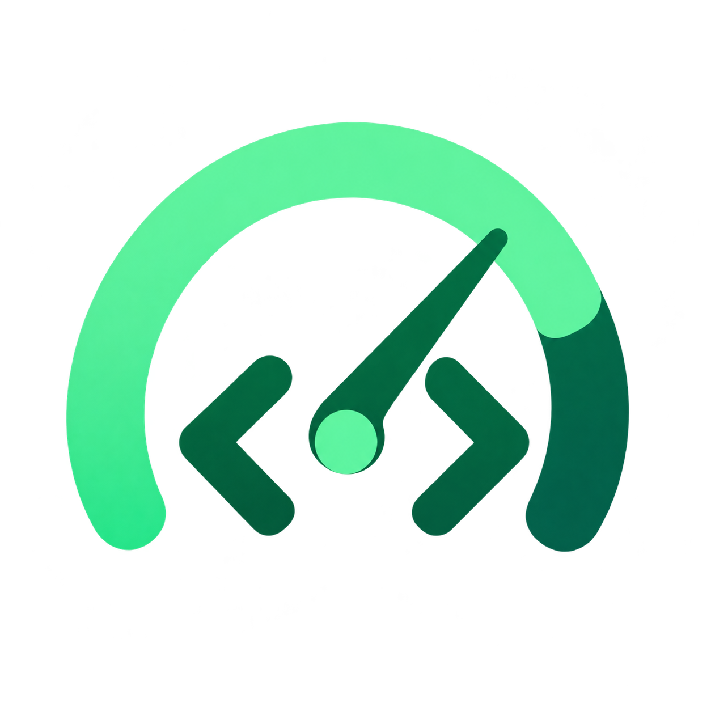
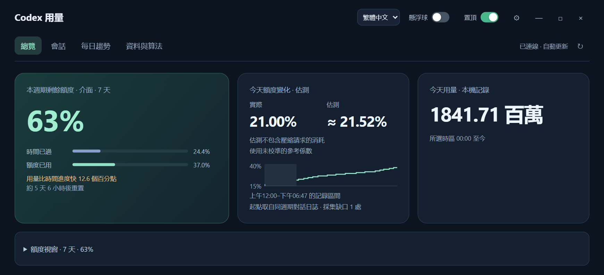
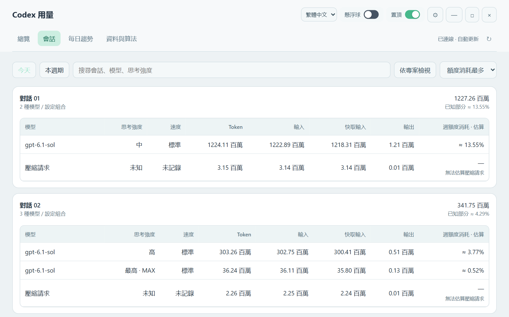

<h1 align="center">CodexGauge · Codex 用量面板</h1>

<strong>每週額度還剩多少，今天主要用在哪裡，打開面板就能查看。</strong>

<a href="../README.md">English</a> · <a href="README.zh-CN.md">简体中文</a> · <strong>繁體中文</strong> · <a href="README.ja.md">日本語</a>

  <a href="https://github.com/HiokiAyu/codex-gauge/releases/tag/ota-preview"><strong>下載 Windows 安裝程式</strong></a> ·
  <a href="../CHANGELOG.md">版本歷史</a> ·
  <a href="../CONTRIBUTING.md">建置與參與開發</a>

Windows x64 · 預覽版 · MIT

擷取自 Windows 11 上執行中的面板。保留用量數字，對話標題已替換。

## 從總覽看什麼

- **額度用得快嗎？** 並列查看每週剩餘額度與週期進度，也可用浮動球隨時查看剩餘百分比。
- **今天用了多少？** 比較帳戶額度讀數的變化和本機對話用量的估測值，曲線會標記擷取中斷的區段。
- **官方每日彙總後來更新了嗎？** 在資料與演算法頁核對官方與本機的每日 Token。系統匣會持續記錄後續修訂的發現時間與變動量。
- **有新的重設或重設卡公告嗎？** 工具自動檢查多個消息來源，發現新的自動重設或可保存的重設卡公告時可發出系統匣通知。面板列出每則消息的來源與比對結果，方便查證。

## 逐一查看對話用量

同一對話切換模型或推理強度時，仍可依各組設定查看輸入、快取與輸出 Token。可切換今日與本週期，也可依專案彙整後匯出 CSV。

## 安裝與使用

1. 到預覽發佈頁的 **Assets** 下載 Windows x64 安裝程式，並在本機 Codex 登入訂閱帳戶。安裝程式可補裝 Microsoft Edge WebView2。
2. 開啟 **總覽** 查看每週額度。右上角 **設定** 可選擇語言、外觀和對話資料目錄。
3. 按 **×** 留在系統匣繼續擷取。完全結束可使用系統匣選單，透過 **設定 → 檢查更新** 取得已簽署的預覽更新。

這是獨立專案，預覽版已於 Windows 11 x64 驗證。OTA 資訊含簽章，獨立安裝程式可能顯示 Windows 的未簽署發行者提示。

## 資料來源與隱私

CodexGauge 讀取本機已登入的 Codex 客戶端和對話日誌。帳戶額度、本機 Token 和額度估測分別標註，估測取決於日誌覆蓋和校準證據。日誌與用量資料庫存放於本機。更新檢查會連線 GitHub，啟用重設消息時會連線至畫面列出的來源。

[回報問題](https://github.com/HiokiAyu/codex-gauge/issues) · [MIT 授權條款](../LICENSE)
